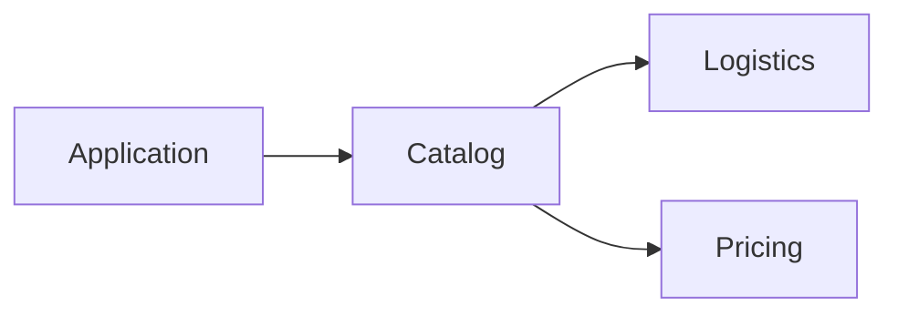

# Effect boundaries demo

Three team-owned packages in one monorepo, using direct Effect service calls
in a single process. Each package has one public entry point, a typed service,
an implementation Layer, and a private repository. There are no separate API
packages, RPC definitions, client adapters, servers, ports, or listeners.

| Team/package | Public operation | Public Layer | Private provider |
| --- | --- | --- | --- |
| `@shop/catalog` | `Catalog.getProduct` | `CatalogLive` | `ProductRepository` |
| `@shop/logistics` | `Logistics.getAvailability` | `LogisticsLive` | `InventoryRepository` |
| `@shop/pricing` | `Pricing.getPrice` | `PricingLive` | `PriceRepository` |



Catalog combines its own product descriptions with availability from Logistics
and a price from Pricing. All calls are ordinary Effect method calls in the
same process. The repositories return sample data; no external services are
needed.

## Run it

Requires Node.js 24+ and Bun (tested with 1.4.4). Git is needed for the optional
rejected-commit simulation.

```sh
git clone https://github.com/marcelsud/effect-boundaries-demo.git
cd effect-boundaries-demo
bun install --frozen-lockfile
bun run check
bun run simulate:violation
```

`check` builds the packages, verifies ten expected compiler failures, exercises
17 forbidden import forms plus two public-name alias attacks, validates
workspace metadata, and runs the direct-call demo. `bun run demo` runs the
demo after building. It prints the product below and exits:

```json
{
  "id": "p-1",
  "name": "Keyboard",
  "availableQuantity": 12,
  "price": { "amountCents": 19900, "currency": "BRL" }
}
```

The runtime checks also cover missing products/prices, a typed
`ProductUnavailable`, a typed `PriceUnavailable`, and zero inventory for an
unknown product.

## Layout and public interfaces

```text
packages/
  catalog/src/
    index.ts                        Public barrel: Catalog, CatalogLive, DTO/error
    Catalog.ts                      Public service and Product types
    internal/Module.ts              Catalog implementation
    internal/ProductRepository.ts   Catalog's private provider
  logistics/src/
    index.ts                        Public barrel: Logistics, LogisticsLive
    Logistics.ts                    Public service
    internal/Module.ts              Logistics implementation
    internal/InventoryRepository.ts Logistics' private provider
  pricing/src/
    index.ts                        Public barrel: Pricing, PricingLive, DTO/error
    Pricing.ts                      Public service and Price types
    internal/Module.ts              Pricing implementation
    internal/PriceRepository.ts     Pricing's private provider
architecture/src/check.ts            Central provider contracts
oxlint.config.ts                     Central import rules and allowed dependencies
scripts/demo.mjs                     One-process application composition
scripts/check-boundaries.mjs         Expected compiler failures
scripts/test-linter.mjs              Import-rule regression checks
scripts/simulate-violation.mjs        Actual rejected commit demonstration
.githooks/pre-commit                 Runs bun run check
.github/CODEOWNERS.example           Illustrative ownership template
```

Each package exposes only `.` in its package exports. Types resolve to
`src/index.ts`, so linting works before the first build. Runtime imports resolve
to compiled `dist/index.js`. Repositories are absent from the public barrels.

For example, Catalog exports:

```ts
export { Catalog, ProductUnavailable } from "./Catalog.js"
export type { Product } from "./Catalog.js"
export { CatalogModule as CatalogLive } from "./internal/Module.js"
```

The public Layers expose only their service capabilities. Each implementation
acquires and captures its own private repository, then satisfies that provider
internally with `Layer.provide(RepositoryLive)`.

## Compose and call the services

The application imports only public entry points:

```ts
import { Effect, Layer } from "effect"
import { Catalog, CatalogLive } from "@shop/catalog"
import { LogisticsLive } from "@shop/logistics"
import { PricingLive } from "@shop/pricing"

const CommerceLive = CatalogLive.pipe(
  Layer.provide(Layer.mergeAll(LogisticsLive, PricingLive))
)

const product = await Effect.runPromise(
  Effect.gen(function* () {
    const catalog = yield* Catalog
    return yield* catalog.getProduct("p-1")
  }).pipe(Effect.provide(CommerceLive))
)
console.log(product)
```

Catalog's implementation obtains `Logistics` and `Pricing` from Effect's
context and calls their methods directly. Its public Layer requires those
two capabilities. Logistics and Pricing have no external provider requirements.

## Two complementary boundaries

`architecture/src/check.ts` checks actual public Layers against this policy:

```ts
type ModulePolicy = {
  catalog: Layer.Layer<Catalog, unknown, Logistics | Pricing>
  logistics: Layer.Layer<Logistics, unknown, never>
  pricing: Layer.Layer<Pricing, unknown, never>
}
```

Changing a team's Layer annotation cannot widen the central policy. But a
provider supplied internally disappears from the exported Layer requirements,
so the import boundary is enforced separately.

`oxlint.config.ts` defines a default-deny graph:

- Catalog may import Logistics and Pricing through their public entry points.
- Logistics and Pricing cannot import other workspace packages.
- The architecture checker may import all three public entry points.
- Imports inside the same package remain allowed.

Every cross-package edge must match both its literal public package name and
the resolved target's `fileInternalPath`: `src/index.ts`, `dist/index.d.ts`, or
`dist/index.js`. There are no exceptions for the architecture checker.

Thus `import { Logistics } from "@shop/logistics"` is allowed in Catalog, while
relative private paths, named private subpaths, and aliases into internals are
rejected. Even an alias spelled `@shop/logistics` or `@shop/pricing` cannot
redirect that public name to a repository file. The compiler also rejects
importing repositories from public barrels or unexported named subpaths.

Oxlint 1.91.0 parses source files. Boundaries 7.4.1 with the TypeScript import
resolver 4.4.5 checks value/type imports, re-exports, import types, dynamic
imports, and direct require calls. Unknown aliases fail closed. Native rules
reject triple-slash references and custom module-loader imports. A small
adapter reuses ESLint 10.14.0's existing restricted-syntax rule for computed
paths and indirect loaders; all selectors live in `oxlint.config.ts`.

`scripts/lint-imports.mjs` enumerates source files using Node's standard globbing
and passes them explicitly to Oxlint. This includes gitignored source files and
files excluded by tsconfig. Oxlint and Boundaries own all source parsing,
resolution, and import analysis; there is no custom import scanner.

`scripts/check-project-graph.mjs` checks JSON metadata using the same exported
policy: forbidden manifest dependencies, forbidden project references, and new
unregistered workspace packages fail. Adding a dependency or reference cannot
grant access. Repository metadata uses plain JSON.

## Simulate an actual rejected commit

Run `bun run simulate:violation`. The script creates a baseline commit using
disposable Git metadata and this directory as its working tree. It temporarily
replaces Catalog's internal implementation with one importing Pricing's private
compiled repository:

```ts
import {
  PriceRepository, PriceRepositoryLive
} from "../../../pricing/dist/internal/PriceRepository.js"
```

It provides the repository internally and exports `Layer.Layer<Catalog>`.
TypeScript alone accepts that replacement, demonstrating why Layer types alone
cannot enforce source boundaries. The script stages the change and attempts:

```sh
git commit -m "Read pricing internals from Catalog"
```

The pre-commit hook runs `bun run check`. Oxlint rejects the internal entry
point, and the script verifies that the commit failed and HEAD is unchanged.
The error points to `packages/catalog/src/internal/Module.ts:5:8` and reports a
forbidden dependency from `packages/catalog` to `packages/pricing`. Public
Pricing access is permitted; the attempted private file is forbidden.

Finally the script restores Catalog's source and deletes its temporary Git
metadata. Your real repository's configuration, index, and history are not
changed. Nothing is pushed by the simulation.

See [the captured simulation transcript](violation-simulation.txt) for the staged
diff and the rejected commit output.

Run `bun run setup:hooks` to configure the hook in a real checkout. Require
`bun run check` on the committed code in CI as well; local hooks can be skipped.
Copy `.github/CODEOWNERS.example` to `.github/CODEOWNERS`, replace the sample team
handles, and require owner review for policy/build/checking-script changes.
Oxlint's JS plugin API is alpha, so dependency versions and the Bun lockfile
are pinned and compatibility is covered by the regression tests.
